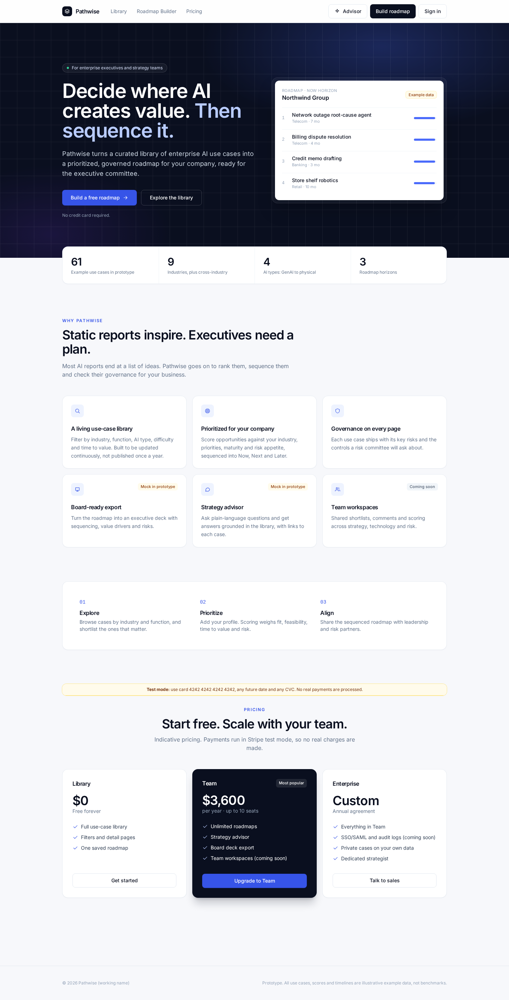
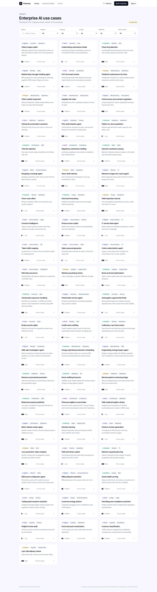
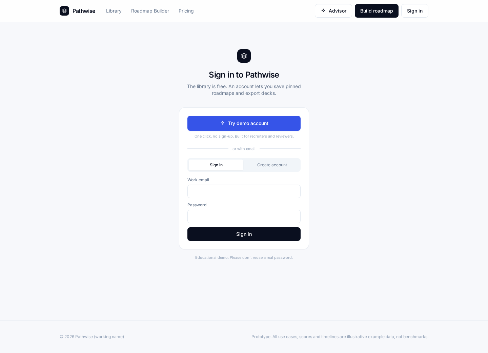
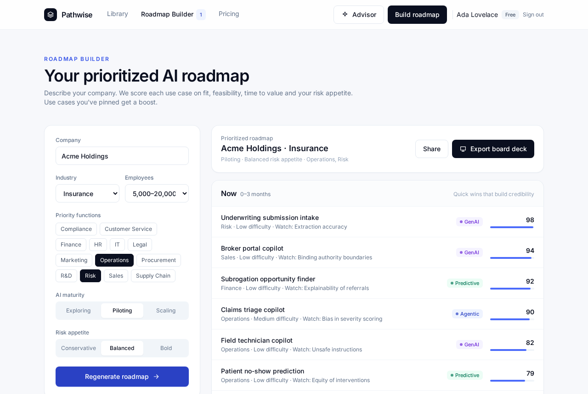
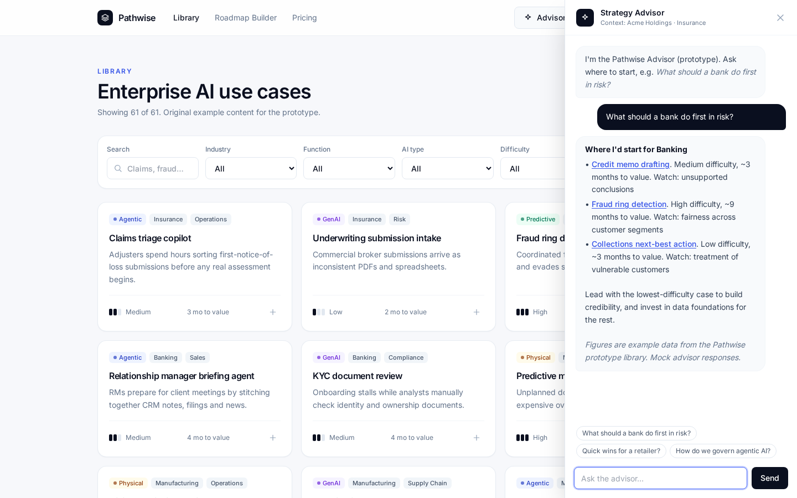
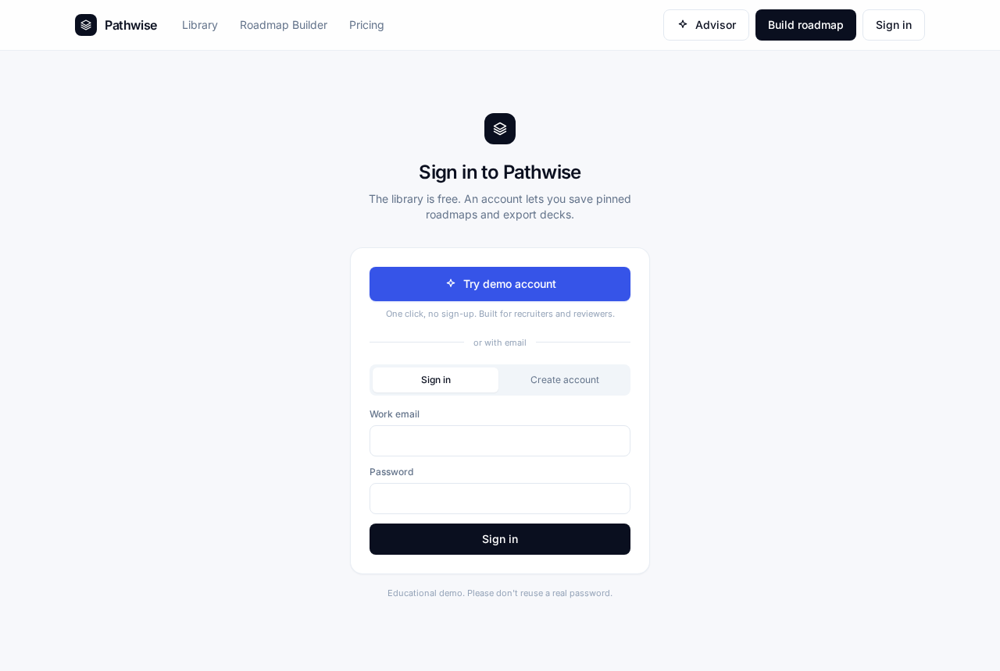
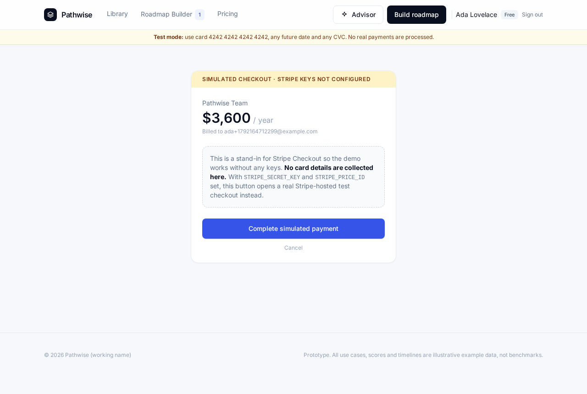
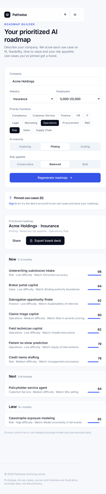

# Pathwise

**Turn enterprise AI use cases into a prioritized, governed roadmap.**

Pathwise is an educational SaaS prototype for enterprise executives and strategy teams. It reimagines the static "AI use-case report" as an interactive product: a filterable library of AI use cases, a Roadmap Builder that ranks and sequences opportunities for a specific company, a strategy advisor, and a freemium business model with accounts and (test-mode) payments.

> **Disclaimer:** This is an educational portfolio project. All use cases, scores, timelines and prices are illustrative **example data**, not benchmarks or advice. It is not affiliated with, endorsed by, or derived from Deloitte or any other firm. The content is original and was inspired by the general format of industry AI use-case reports.



## Screenshots

| Library | Use-case detail |
|---|---|
|  |  |
| **Roadmap Builder** | **Strategy Advisor (mock)** |
|  |  |
| **Sign in / demo account** | **Checkout (simulated or Stripe test mode)** |
|  |  |



## Features

- **Use-case library (free):** 61 original example use cases across 9 industries plus cross-industry. Filter by industry, function, AI type (GenAI, Agentic, Predictive, Physical), implementation difficulty and time to value.
- **Use-case detail:** problem, solution, data needs, value drivers, risks and governance, and implementation path.
- **Roadmap Builder:** enter a company profile (industry, size, priority functions, AI maturity, risk appetite) and get a transparent rule-based ranking sequenced into Now, Next and Later horizons. Pinned use cases get a boost.
- **Accounts:** email sign-up and sign-in, plus a one-click **Try demo account**. Pinning use cases and exporting the board deck require sign-in. The library stays open.
- **Payments:** Stripe Checkout in **test mode only** for the Team plan, with verify-on-return upgrading the account to Pro. Without keys, a clearly labelled simulated checkout keeps the demo working.
- **Strategy advisor:** a mock, keyword-grounded advisor that cites library cases with links. Industries named in the question take priority over the saved profile. An archived LLM-backed version lives in `src/advisor-live/` and is not used by the front end.
- **Responsive, accessible UI** with an enterprise design system (Inter, ink and blue palette, subtle motion).

## Tech stack

- **Front end:** React 18, React Router (hash routing), Tailwind CSS 3, Vite 5
- **Back end:** Vercel-style serverless functions in `/api` (Node 18+), **zero runtime dependencies** (`node:crypto` and `fetch`)
- **Auth:** scrypt password hashing, plus HMAC-signed, HttpOnly, SameSite=Lax session cookies (7 days)
- **Storage:** Upstash Redis or Vercel KV over REST if configured. Otherwise a local JSON file (`.data/users.json`) on dev, or ephemeral `/tmp` on serverless.
- **Payments:** Stripe REST API (Checkout Sessions), test keys enforced
- **Testing:** Playwright headless end-to-end scripts that also generate screenshots

## Architecture

```
Browser (React SPA)
  ├─ Library / Detail / Roadmap / Advisor   ← static data in src/data.js (example content)
  ├─ Pins + profile                         ← localStorage, keyed per signed-in user
  └─ fetch /api/*  ───────────────►  Serverless functions (api/)
                                      ├─ auth/signup, login, logout, me, demo
                                      │    └─ signed session cookie · user store (_lib.js)
                                      └─ billing/checkout ──► Stripe Checkout (test) ──┐
                                         billing/verify  ◄── success redirect ◄───────┘
                                         billing/simulate (only when Stripe is not configured)
```

- In local dev and preview, `vite-api-plugin.js` mounts the same `api/*.js` handlers as middleware, so `npm run dev` runs the full stack with no extra server.
- On Vercel, files in `api/` deploy as serverless functions automatically. Files prefixed with `_` are helpers, not routes.
- The **demo account** is stateless (a signed cookie, no database), so it works on any deployment.
- **Pro status** is stored in the session cookie and, for email accounts, in the user store.

## Run locally

```bash
npm install
npm run dev            # http://localhost:5173 (front end + /api)
# or a production build:
npm run build && npm run preview   # http://localhost:4173
```

There are no env vars, accounts or keys needed. Use **Try demo account**, or sign up with any email. Accounts are saved to `.data/users.json`, which is git-ignored.

End-to-end check and screenshots (needs `npx playwright install chromium` once, and the preview server running):

```bash
npm run test:e2e   # sign-up, sign-in, gating, demo, simulated checkout → shots/auth/
npm run shots      # desktop + mobile page screenshots → shots/polish/
```

## Environment variables

All are optional. Copy `.env.example` to `.env.local` for `vercel dev`, or set them in the Vercel dashboard.

| Variable | Purpose |
|---|---|
| `AUTH_SECRET` | Secret for signing session cookies. **Set this in any deployment.** |
| `STRIPE_SECRET_KEY` | Stripe **test** secret key (`sk_test_…`). Live keys are rejected. |
| `STRIPE_PRICE_ID` | Test-mode recurring Price ID for the Team plan |
| `UPSTASH_REDIS_REST_URL` / `UPSTASH_REDIS_REST_TOKEN` | Persistent user store (Vercel KV's `KV_REST_API_URL` / `KV_REST_API_TOKEN` also work) |
| `APP_URL` | Public base URL used for Stripe redirects (auto-detected if unset) |

With Stripe configured, pay with test card **4242 4242 4242 4242**, any future expiry date and any CVC. This project never handles card data: payment happens on Stripe-hosted Checkout.

## Deploy to Vercel

```bash
npx vercel login     # one-time browser or email login
npx vercel           # preview deploy
npx vercel --prod    # production
```

Or import the GitHub repo at vercel.com/new, since the framework is detected automatically. Set `AUTH_SECRET` at minimum. Without a Redis store, email accounts on Vercel are ephemeral, but the demo account always works.

## Limitations

- Example data only. Scoring is a transparent rule-based model, not a validated methodology.
- The board deck export, Share and team workspaces are mocked or coming soon. The advisor is a mock.
- There's no password reset or email verification, and no rate limiting on auth endpoints. This is an educational project, so please don't reuse a real password.
- No Stripe webhook: Pro is granted by verify-on-return, which is fine for a demo but not for production billing.

## Built with AI-assisted development

This project was built with AI-assisted development. I directed the product strategy, scope, pricing model, UX and content decisions, and an AI coding agent helped implement the code, write example content, and run headless tests and screenshots. All content is original and labelled as example data.

## License

MIT, for educational use.
